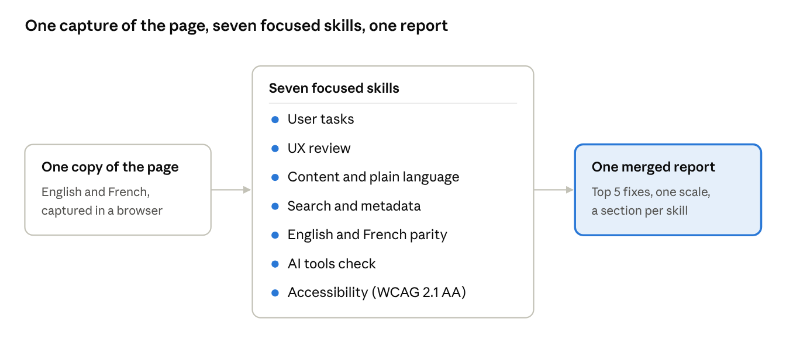

# One prompt wasn't enough: what I learned building a page audit suite with AI

*Lana Stewart · November 5, 2026*

This started with my colleague [David](https://github.com/quidampepin). He'd been building
[page-builder](https://github.com/quidampepin/page-builder), an app that assesses and rebuilds
Canada.ca pages: it analyzes real user feedback and analytics, works out the tasks a page should
support, reviews the page and proposes fixes. Watching his work gave me more ideas for
understanding how content performs, starting with something I spend a lot of my time on: making
sense of user feedback.

So I tried it on feedback analysis first. At the time, my way of using AI was a saved prompt:
paste in comments or a page, ask for an analysis, get back a wall of observations. Some were
useful. Some were confidently wrong. None of them were the same twice.

What came out of that wasn't a neat plan. It was a set of small, focused AI skills that grew in
different ways. Some started as David's and I kept iterating on them. Some I built from scratch.
Others came straight out of problems at work: a report nobody could read, a count nobody
trusted, a French page that said something slightly different from the English. Together they
cover user tasks, UX, content, search, English and French parity, accessibility, and whether AI
tools like ChatGPT or Copilot would give people the right answer. One final skill runs them all
on the same page and merges what they find into one report.

This post is about what changed when I did that, and what I'd tell anyone trying the same thing.

## What the suite does

You give it a Canada.ca address. It captures the English and French pages once, runs each skill
against that same copy, and merges the results. If three skills spot the same problem, it shows
up once, with all three named. The report opens with a grade, the single most important finding
and the five fixes worth doing first.

## What I learned

### 1. Look at the real page, not a summary

My first audits used a tool that fetched the page and summarized it. The summaries were wrong in
small, believable ways: an anchor link that "didn't exist" did, and hidden search data that
"wasn't there" was. Now every audit captures the exact page code in a browser first, and every
finding is checked against that copy. If something can't be confirmed, it's labelled "needs a
test" instead of reported as fact.

### 2. Count with code, not with vibes

Researcher [Dr. Cody Dodd](https://github.com/codydodd) was skeptical that AI can count feedback
comments, because it stops reading closely partway through a long list. He was right. His
[validation-first thematic measurement](https://github.com/codydodd/validation-first-thematic-measurement)
framework puts it simply: measurement follows validation. Automated theme tagging has to be
checked against a sample a person has coded before anyone reports the numbers. So the feedback
skill now labels every comment by ID, counts them with a script, keeps a table showing which
comment went where, and says plainly whether the counts have been checked against a human-coded
sample yet. The same goes for sentence lengths: a script measures every sentence, and the report
charts it.

### 3. One scale for everything

When each skill rated problems its own way, the merged report was a mess of "High", "Major" and
"Needs attention". Now every finding uses the same three levels (Critical, Major, Minor) and the
same three confidence tags. That one change made the reports far easier to compare across pages.

### 4. Plain language applies to the AI parts too

I called one check "AI reuse readiness". Nobody knew what it meant, including me a week later.
It became three plain questions: Can AI tools find the page? Is there a clear answer to copy?
Will they repeat it correctly? Each one gets a Yes, Partly or No.

### 5. The report is a product

The findings were good long before anyone wanted to read them. What helped was treating the
report like any other piece of content: an at-a-glance panel at the top, the five fixes that
matter most with how much effort each takes, plain section names instead of "Appendix C", and
every finding saying exactly where it is on the page. When a colleague can't find an issue you
flagged, the issue doesn't get fixed.

## What's next

The suite doesn't replace people. It does the checking, the counting and the cross-referencing,
so the people who know the program and the users can spend their time on judgement. Next, I
want to test it on more pages and measure how much time it actually saves.

If you're building something similar, you don't have to start from nothing. Borrow a
colleague's skill and improve it, or start from the problem that annoys you most at work. Run it
on a real page, check it against the source, and keep iterating.

Thanks again to David, whose [page-builder](https://github.com/quidampepin/page-builder) started
all this and shaped the accessibility scan and the fix list, to Chelsey Donohue, whose
bilingual audit skill I adapted, and to Dr. Cody Dodd, whose push on validation changed how the
suite counts.

*This is a personal project, and the views here are my own.*
